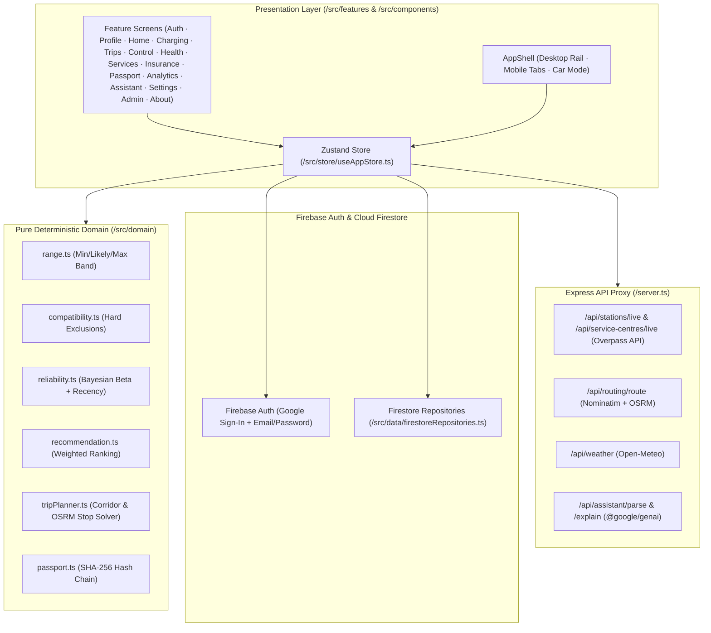

# ChargeSense: EV Intelligence & Ownership OS

Unified explainable decision layer for electric-vehicle owners along the **Bengaluru – Mysuru, Karnataka** corridor, built with React, TypeScript, Firebase Auth, Cloud Firestore, live OpenStreetMap/OSRM/Open-Meteo feeds, and server-side Gemini AI.

> **Honesty Note**: Charging stations, road routing, ambient weather, user profiles, garage vehicles, trips, service bookings, claims, and SHA-256 passport records run on live external APIs and Cloud Firestore. Hardware-dependent vehicle controls (live CAN-bus telemetry, door locks, cabin HVAC, valet, geofence, sentry, and V2G toggles) are explicitly labelled `Simulated` until paired with an OEM telematics API.

## Architecture Diagram



## Folder Structure

```text
/
├── server.ts                          # Express server + Vite dev/prod middleware + live API proxies
├── firestore.rules                    # Deployed Cloud Firestore security rules
├── firebase-blueprint.json            # Firestore schema blueprint
├── firebase-applet-config.json        # Firebase project & database configuration
├── index.html
├── metadata.json
├── package.json
├── README.md
└── src/
    ├── App.tsx                        # Router & protected route wiring
    ├── index.css                      # Tailwind v4 + Material 3 design tokens (dark/light)
    ├── main.tsx
    ├── lib/
    │   └── firebase.ts                # Firebase App, Auth, Firestore initialization & error boundary helper
    ├── domain/                        # Pure TypeScript business logic (0 UI imports)
    │   ├── types.ts
    │   ├── schemas.ts                 # Zod validation schemas
    │   ├── range.ts                   # Deterministic range band estimator
    │   ├── compatibility.ts           # Hard connector/status/range exclusion filters
    │   ├── reliability.ts             # Bayesian-smoothed reliability & confidence
    │   ├── recommendation.ts          # Weighted station recommendation engine
    │   ├── tripPlanner.ts             # RoutingProvider + corridor/OSRM stop solver
    │   ├── passport.ts                # SHA-256 hash-chained EV Digital Passport
    │   └── __tests__/
    │       └── domain.test.ts         # Vitest unit tests & edge cases
    ├── data/                          # Repository interfaces, Firestore repos, & Indian EV templates
    │   ├── repositories.ts
    │   ├── firestoreRepositories.ts
    │   ├── mockRepositories.ts
    │   └── seed/
    │       ├── stations.ts            # Unit test fixtures
    │       ├── vehicles.ts            # Indian EV spec templates for quick-add
    │       └── records.ts             # EV knowledge base FAQs
    ├── services/
    │   ├── liveApi.ts                 # Typed client wrapper for /api/* live endpoints
    │   └── orchestrators.ts           # TelemetrySimulator & origin constants
    ├── store/
    │   └── useAppStore.ts             # Zustand state synchronized with Firebase Auth + Firestore
    ├── components/                    # Reusable Material 3 design system
    │   ├── auth/ProtectedRoute.tsx
    │   ├── layout/AppShell.tsx
    │   ├── DemoBadge.tsx
    │   ├── ErrorBoundary.tsx
    │   ├── M3Switch.tsx
    │   ├── RippleButton.tsx
    │   ├── Skeleton.tsx
    │   ├── SocRing.tsx
    │   ├── ToastViewport.tsx
    │   └── TonalCard.tsx
    └── features/                      # Screen modules
        ├── landing/LandingPage.tsx
        ├── auth/AuthPage.tsx
        ├── onboarding/OnboardingPage.tsx
        ├── home/HomeOverviewPage.tsx
        ├── charging/ChargingPage.tsx
        ├── trips/TripPlannerPage.tsx
        ├── control/VehicleControlPage.tsx
        ├── health/BatteryHealthPage.tsx
        ├── services/ServicesPage.tsx
        ├── insurance/InsurancePage.tsx
        ├── passport/PassportPage.tsx
        ├── analytics/AnalyticsPage.tsx
        ├── assistant/AssistantPage.tsx
        ├── settings/SettingsPage.tsx
        ├── admin/AdminPage.tsx
        └── about/AboutLimitationsPage.tsx
```

## Verification Commands

- `npm test` — Runs Vitest domain unit tests (`src/domain/__tests__/domain.test.ts`).
- `npm run lint` — TypeScript typecheck (`tsc --noEmit`).
- `npm run build` — Production Vite bundle.
- `npm start` — Runs `server.ts` in production mode on port 3000.
