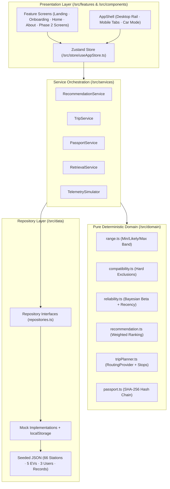

# ChargeSense: EV Intelligence & Ownership OS

Unified explainable decision layer for electric-vehicle owners along the **Bengaluru – Mysuru, Karnataka** corridor.

> **Honesty Note**: This application runs entirely in the browser with a clearly separated mock data layer (`Demo data` / `Simulated`). No live vehicle CAN-bus or real-world charger OCPI network is connected.

## Architecture Diagram



## Folder Structure

```text
/
├── index.html
├── metadata.json
├── package.json
├── README.md
└── src/
    ├── App.tsx
    ├── index.css                     # Tailwind v4 + Material 3 design tokens (dark/light)
    ├── main.tsx
    ├── domain/                       # Pure TypeScript business logic (0 UI imports)
    │   ├── types.ts
    │   ├── schemas.ts                # Zod validation schemas
    │   ├── range.ts                  # Deterministic range band estimator
    │   ├── compatibility.ts          # Hard connector/status/range exclusion filters
    │   ├── reliability.ts            # Bayesian-smoothed reliability & confidence
    │   ├── recommendation.ts         # Weighted station recommendation engine
    │   ├── tripPlanner.ts            # RoutingProvider + corridor stop solver
    │   ├── passport.ts               # SHA-256 hash-chained EV Digital Passport
    │   └── __tests__/
    │       └── domain.test.ts        # Vitest unit tests & edge cases
    ├── data/                         # Repository interfaces & mock persistence
    │   ├── repositories.ts
    │   ├── mockRepositories.ts
    │   └── seed/
    │       ├── stations.ts           # 66 fictional Bengaluru–Mysuru corridor stations
    │       ├── vehicles.ts           # 5 EV profiles + 3 demo users
    │       └── records.ts            # Trips, claims, service centres, FAQs, passport
    ├── services/                     # Orchestration & simulation state machine
    │   └── orchestrators.ts
    ├── store/                        # Zustand global state
    │   └── useAppStore.ts
    ├── components/                   # Reusable Material 3 design system
    │   ├── layout/AppShell.tsx       # Desktop rail, mobile bottom nav, Car Mode
    │   ├── DemoBadge.tsx
    │   ├── ErrorBoundary.tsx
    │   ├── M3Switch.tsx
    │   ├── RippleButton.tsx
    │   ├── Skeleton.tsx
    │   ├── SocRing.tsx
    │   ├── ToastViewport.tsx
    │   └── TonalCard.tsx
    └── features/                     # Screen modules
        ├── landing/LandingPage.tsx
        ├── onboarding/OnboardingPage.tsx
        ├── home/HomeOverviewPage.tsx
        ├── about/AboutLimitationsPage.tsx
        ├── notfound/NotFoundPage.tsx
        └── shared/PhaseTwoPlaceholder.tsx
```

## Verification Commands

- `npm test` — Runs Vitest domain unit tests (`src/domain/__tests__/domain.test.ts`).
- `npm run lint` — TypeScript typecheck (`tsc --noEmit`).
- `npm run build` — Production Vite bundle.
